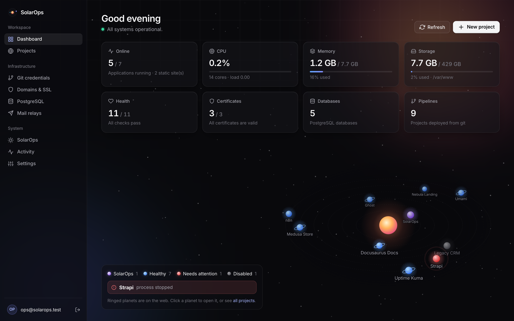
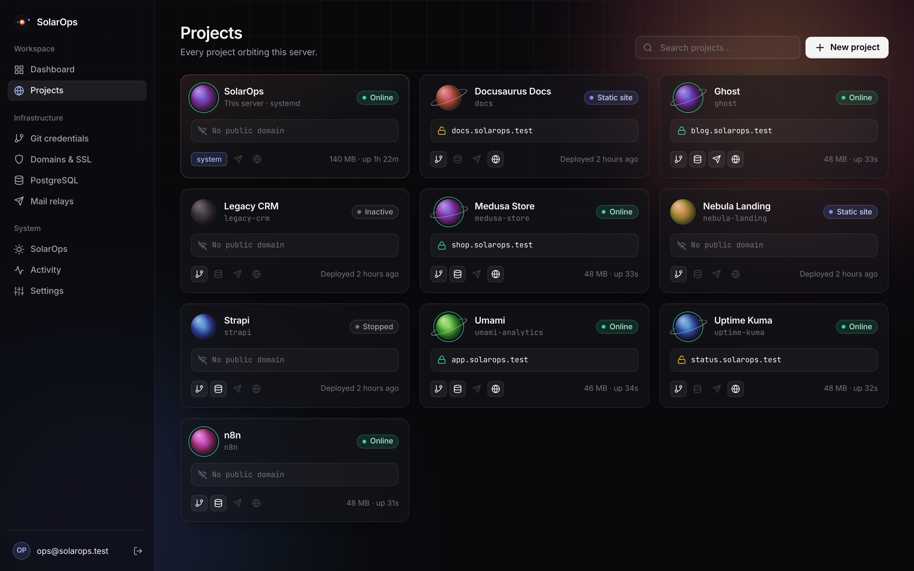
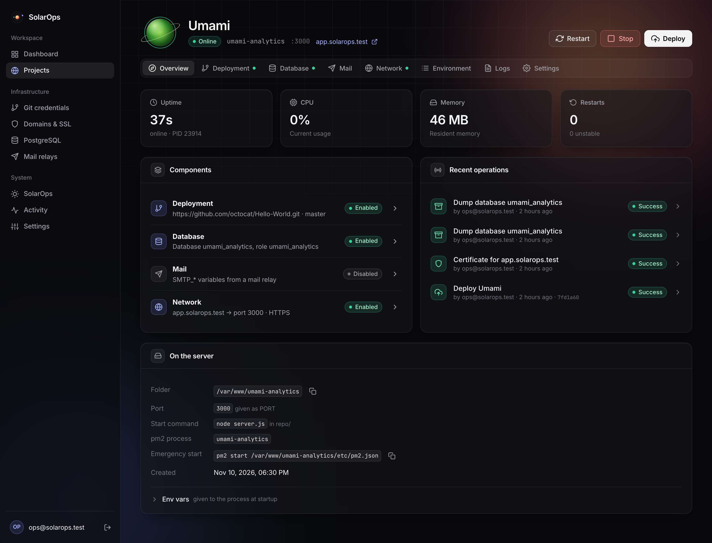
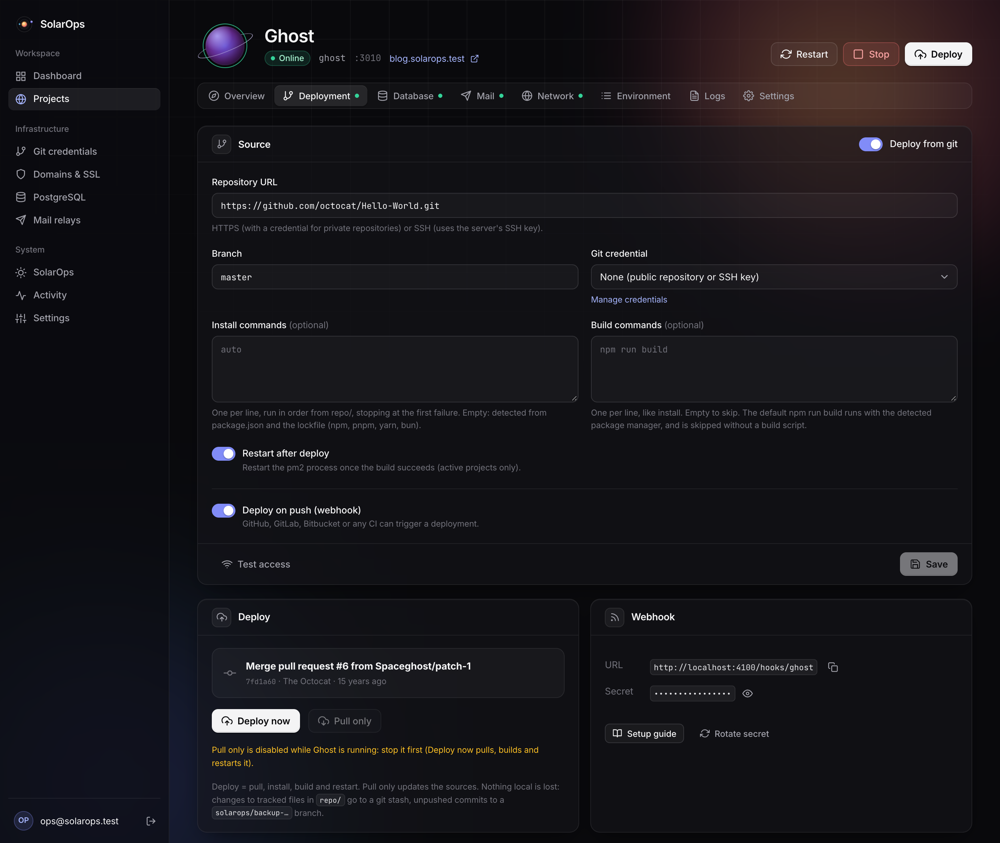
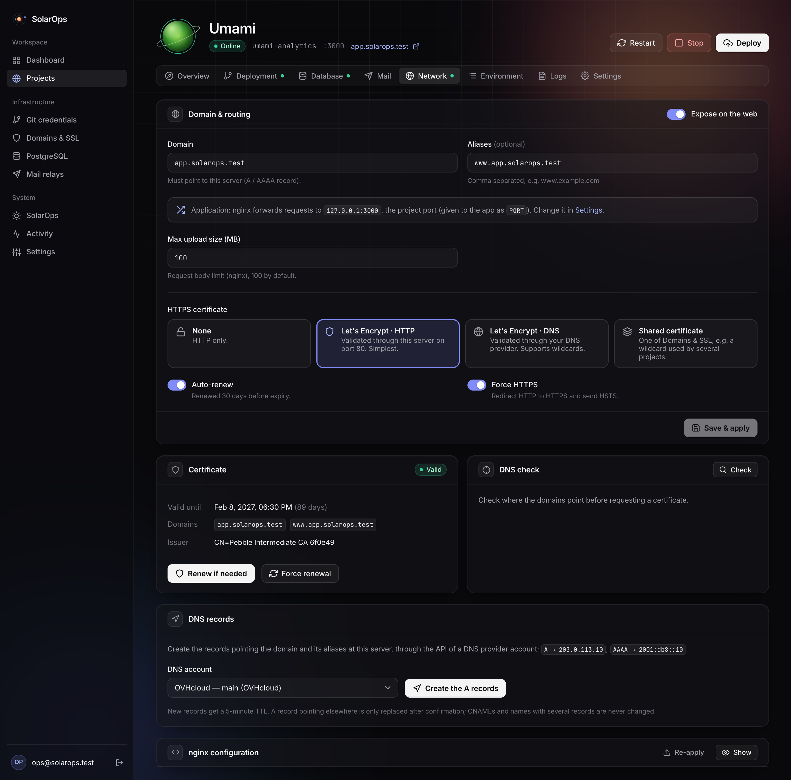
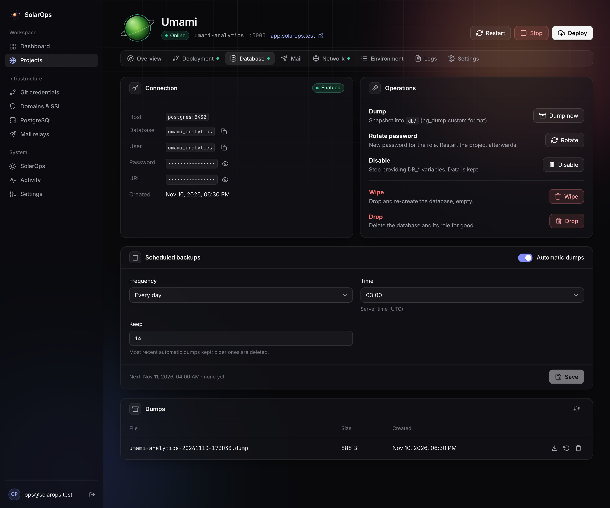
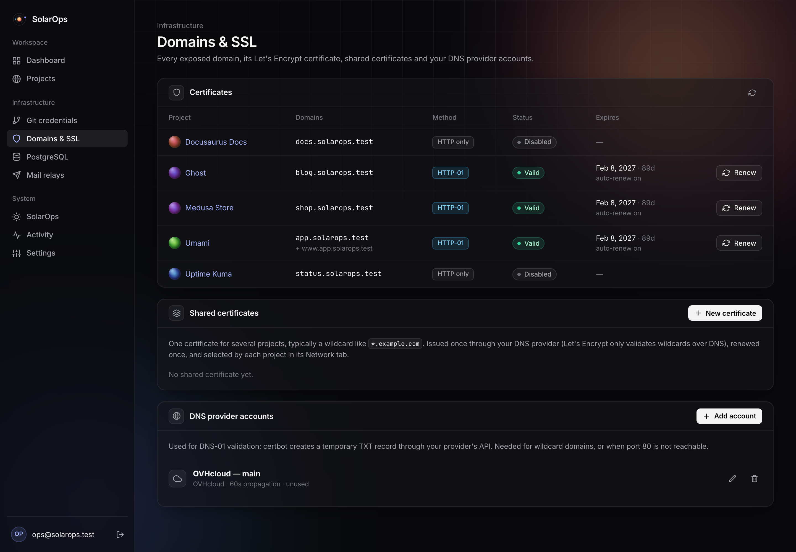
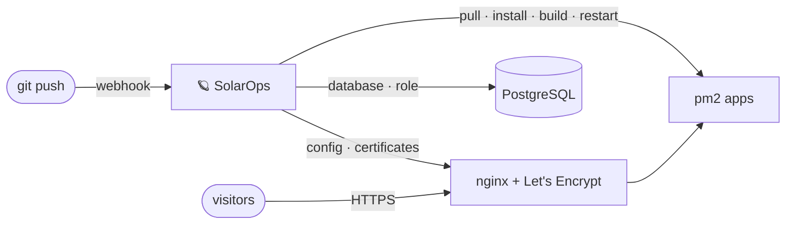

<div align="center">

# 🪐 SolarOps

### Mission control for your VPS

Deploy, run and secure all your projects on a single server, from one beautiful web UI.<br>
Your own little platform: no containers, no YAML, no lock-in.

[](LICENSE)


[Features](#-features) · [Screenshots](#-screenshots) · [How it works](#-how-it-works) · [Quick start](#-quick-start) · [Docs](docs/README.md)

</div>

<br>



Got a VPS and a dozen side projects? **SolarOps** turns that server into your own little PaaS.
Push to git: it builds, restarts and checks your app, serves it over HTTPS, and hands it a
PostgreSQL database and a mail relay. Under the hood it's plain nginx, pm2, certbot and
PostgreSQL, so nothing you couldn't still run by hand.

## ✨ Features

<table>
<tr>
<td width="50%" valign="top">

**🚀 Push to deploy**<br>
Pull, install, build and restart on every push, from GitHub, GitLab, Bitbucket or any CI.
npm, pnpm, yarn and bun are detected, and a deployment fails if the app doesn't answer.

</td>
<td width="50%" valign="top">

**🔒 HTTPS everywhere**<br>
Let's Encrypt certificates over HTTP or DNS, renewed automatically. Wildcard certificates are
issued once and shared across projects.

</td>
</tr>
<tr>
<td valign="top">

**🐘 A database per project**<br>
An isolated PostgreSQL database and role, handed to the app as `DATABASE_URL`. Dumps, restore
and scheduled backups.

</td>
<td valign="top">

**🌍 DNS on autopilot**<br>
A and AAAA records created for you through your OVHcloud, Cloudflare or DigitalOcean account.

</td>
</tr>
<tr>
<td valign="top">

**📦 Apps and static sites**<br>
Node apps run under pm2 on their own port; static sites are built and served by nginx.
Environment variables, mail relays, live logs and metrics included.

</td>
<td valign="top">

**🪐 A dashboard with a view**<br>
CPU, memory, storage and health checks, over your projects orbiting as an animated solar
system. E-mail alerts when something goes wrong.

</td>
</tr>
<tr>
<td valign="top">

**🛡️ Secure by design**<br>
Unprivileged service user, secrets encrypted at rest, nginx changes rolled back on failure,
audit journal, and a CLI to get back in.

</td>
<td valign="top">

**🤝 Moves in gently**<br>
Adopts existing folders, databases and pm2 processes, and never overwrites what it didn't
create.

</td>
</tr>
</table>

## 📸 Screenshots

| Projects | Project overview |
| --- | --- |
|  |  |

| Deployment | Network |
| --- | --- |
|  |  |

| Database | Domains & SSL |
| --- | --- |
|  |  |

<sub>Demo projects running a placeholder app on the [Docker test bench](docker/README.md).</sub>

## 🔭 How it works



- **One folder per project**: `repo/`, `etc/` (generated nginx and pm2 config, certificates),
  `db/` (dumps) and `logs/`. Inspect it, back it up, or start it by hand.
- **Nothing to lock you in**: projects keep running when SolarOps is down, and the generated
  config is plain nginx and pm2.
- **Least privilege**: SolarOps runs as its own user; its only root powers are `nginx -t` and
  `systemctl reload nginx`.

## 🚀 Quick start

You need a Debian 12+ or Ubuntu 22.04+ server with **Node.js 24** installed for the whole system
([how](docs/installation.md#requirements)), and a domain pointing at it.

```bash
sudo git clone https://github.com/myeti/solar-ops.git /var/solarops
```

```bash
cd /var/solarops && npm run setup
```

The setup asks for SolarOps's domain and your e-mail (for Let's Encrypt). Then open
`https://<your domain>/setup`, paste the setup token it printed, and create your admin. Add your
first project: you're in orbit. 🛰️

Day to day, from the same folder: `npm run start`, `stop`, `restart`, and `npm run update`, which
pulls the new version, migrates the database after a backup, and goes back by itself if anything
fails. The setup only adds what's missing, never replaces what's already installed, and is
remembered: updates never change it. Want to try it first? The [Docker test bench](docker/README.md)
runs a throwaway VPS, with real certificates from a local Let's Encrypt test server.

## 📚 Documentation

| Guide | What's inside |
| --- | --- |
| [**Installation**](docs/installation.md) | Setup and its options, existing PostgreSQL, no domain, day-to-day commands, updates and rollback, configuration |
| [**User guide**](docs/guide.md) | Projects, deployments, databases, domains, certificates, DNS records, webhooks |
| [**How it works**](docs/architecture.md) | What SolarOps drives on the server, project folders |
| [**Security**](docs/security.md) | Security model, emergency recovery CLI, backups |
| [**Development**](docs/development.md) | Local setup, lint, test bench, code layout |

<br>

<div align="center">

Built with Node.js · Express · Vue · Sequelize · nginx · pm2 · certbot · PostgreSQL

[MIT](LICENSE) © 2026 Magalon

</div>
